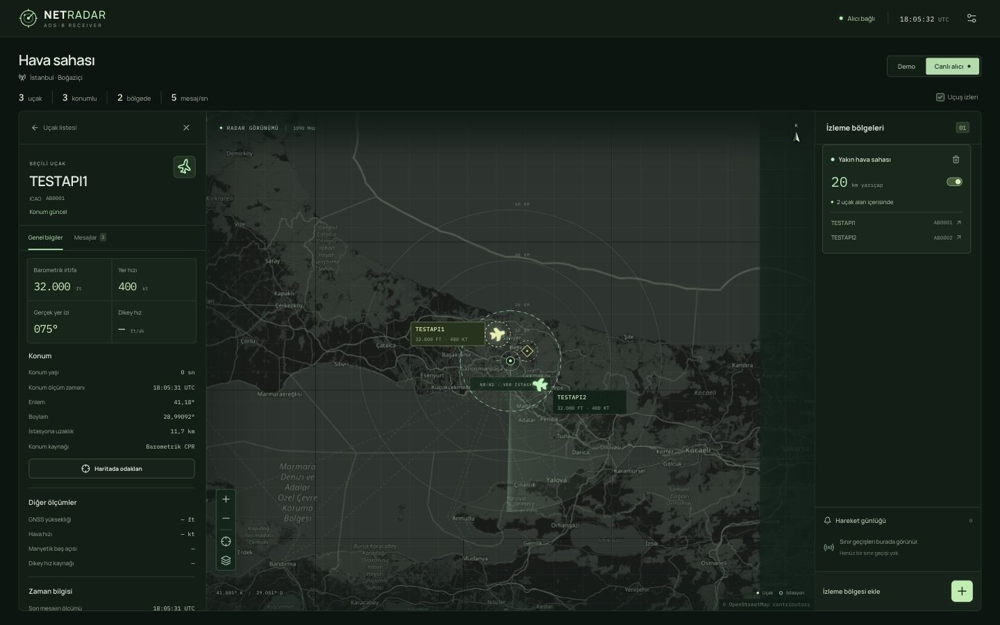

# FastAPI ile canlı veri servisi — ilk adım

Bu adım mevcut decoder ve `AircraftStore` üzerine HTTP/WebSocket taşımasını ekler.
Arayüz React olarak kalır; FastAPI Python backend'idir.

## 1. Akış

```text
DSP → ModeSFrame → DecoderPipeline → DecodedEvent
                                        │
                    POST /api/events ← forward / Python producer
                                        │
                                  TrafficService
                                        │
                                  AircraftStore
                                   /         \
                    GET /api/aircraft       WS /ws/aircraft
                       ilk durum             yeni güncellemeler
                                   \         /
                                  React haritası
```

`POST` girişi **DecodedEvent** alır, istemcinin ürettiği uçak özetini almaz.
Backend kendi durumunu kendisi hesaplar. `forward`, mevcut pipeline'ın JSONL
çıktısındaki `event` alanını ayıklayıp gönderir. Aynı süreçte çalışan bir üretici
doğrudan `await service.handle_frame(frame)` kullanabilir.

## 2. Kurulum ve başlatma

Repo kökünde, Python 3.10 veya daha yeni bir sürümle:

```bash
python3 -m venv .venv
.venv/bin/python -m pip install -r requirements-dev.txt
.venv/bin/python -m uvicorn netradar.backend.server:app \
  --host 127.0.0.1 --port 8000 --workers 1
```

Yalnız servisi çalıştırmak için `requirements-backend.txt` yeterlidir.
`requirements-dev.txt`, buna HTTP/WebSocket test istemcisini ekler.

- Sağlık kontrolü: `http://127.0.0.1:8000/healthz`
- Mevcut uçaklar: `http://127.0.0.1:8000/api/aircraft`
- Etkileşimli API belgesi: `http://127.0.0.1:8000/docs`

Başlangıçta snapshot `[]` döner. Sunucu kendiliğinden demo uçak üretmez.
Durum bu ilk aşamada bellektedir; süreç yeniden başlayınca temizlenir.
**Tek worker kullanılır.** Birden çok worker ayrı uçak hafızaları ve aboneler
oluşturur. Çoklu süreç ölçeklemesi için ortak broker/durum katmanı sonraki iştir.

## 3. Mevcut decoder'ı servise bağlama

Sunucu çalışırken başka terminalde:

```bash
.venv/bin/python -m netradar.pipeline \
  --fixture fixtures/synthetic_adsb_2msps.json \
  | .venv/bin/python -m netradar.backend.forward
```

Bu komut fixture metadata'sındaki bilinen çerçeveleri kullanır; IQ tespiti veya
gerçek RF alımı yapmaz. Yedi decoder olayı servise aktarılır. Örneklerin uçak
koordinatları İstanbul'da olmak zorunda değildir; harita listesinden uçak seçip
**Haritada odaklan** kullanılabilir. Sonlu fixture bittikten sonra konumların
eskimesi beklenen davranıştır. Ölçülmüş mutlak saati olmayan kayda şu anın saati
eklenmez.

DSP'nin üreteceği gerçek `ModeSFrame` JSONL için:

```bash
.venv/bin/python -m netradar.pipeline --input frames.jsonl \
  --sample-rate-hz 2000000 \
  | .venv/bin/python -m netradar.backend.forward --url http://127.0.0.1:8000
```

Mevcut decoder publisher callback'i de ayrı üretici sürecinde bağlanabilir:

```python
from netradar.backend.forward import send_event
from netradar.contracts import DecodedEvent
from netradar.pipeline import DecoderPipeline

def publish(update):
    send_event("http://127.0.0.1:8000", DecodedEvent.from_dict(update["event"]))

pipeline = DecoderPipeline(publish=publish)
# DSP hazır olduğunda: pipeline.handle_frame(frame)
```

Bu HTTP üreticisi bloklayıcıdır; ASGI event loop'unda çalıştırılmaz. Servisle aynı
loop'taki üretici için `await app.state.traffic.handle_frame(frame)` kullanılır.
Başka bir thread doğrudan store'u değiştirmemelidir; HTTP kullanabilir veya
`asyncio.run_coroutine_threadsafe(..., asgi_loop)` ile sahibine iş bırakabilir.
`forward` bağlantı hatasında satır numarasıyla durur; kalıcı kuyruk veya otomatik
yeniden gönderme henüz yoktur. HTTP yanıtı kaybolursa olayın uygulanıp
uygulanmadığı belirsiz olabilir; bu ilk taşıma exactly-once garantisi vermez.

## 4. Arayüz bağlantısı

Frontend'i normal şekilde açın. Alıcı ayarlarında backend adresi
`http://localhost:8000` olsun; **Canlı alıcı** seçin.

1. WebSocket açılır. Backend aboneliği handshake tamamlanmadan kaydeder.
2. Arayüz HTTP snapshot ister; bu sırada gelen WS mesajlarını tamponlar.
3. Snapshot yerleştirilir, tampon mesajları uygulanır.
4. Her yeni olay mevcut v1.1 `aircraft_update` zarfıyla aktarılır. Sayfa yenilenmez.

Bu sırada snapshot, tampondaki bazı mesajlardan yeni olabilir. Servis her özete
ve zarfına `stream_id` ve `stream_sequence` ekler. Snapshot da ilgili uçağın son
sırasını taşır. Aynı oturumda daha düşük/eşit sıradaki özet mevcut durumu geri
alamaz; ham gelen olay inceleme için korunur. Sunucu yeniden başlarsa `stream_id`
değişir; eski oturumun yüksek sayacı yeni oturumu bloke etmez. Sıra numarası
ölçüm zamanı değildir ve [konum güncelliği](POSITION_FRESHNESS.md) kurallarının
yerine geçmez. Saatlerce gecikmiş bir ölçüm servise yeni ulaşmış olsa da konumu
geri alamaz.

## 5. Endpoint sözleşmesi

| Endpoint | Girdi | Çıktı |
| --- | --- | --- |
| `GET /healthz` | — | `status: ok`, şema sürümü |
| `GET /api/aircraft` | — | Düz uçak dizisi; `Cache-Control: no-store` |
| `POST /api/events` | Tam `DecodedEvent` | Aynı olaydan üretilen tam `aircraft_update` |
| `WS /ws/aircraft` | Sunucudan veri almak için bağlantı | Her mesajda tek tam `aircraft_update` |

`fields` ve `metadata` içindeki bilinmeyen JSON uzantıları korunur. Geçersiz ICAO,
olay tipi, şema, koordinat, ölçüm saati veya sonlu olmayan sayı **422** döner;
uçak hafızası değişmez. WebSocket veri giriş kanalı değildir; oraya istemci
mesajı göndermek **1008** ile kapatılır.

## 6. Yavaş/kopmuş istemciler

Her WebSocket'in 256 mesajlık ayrı kuyruğu vardır. Yayın sırasında ağ beklenmez.
Kuyruk taşarsa o istemci **1013** ile kapatılır; veri atlandığı gizlenmez.
Frontend yeniden bağlanıp güncel snapshot alır. TCP gönderimi 5 saniyede
tamamlanmazsa da aynı yeniden bağlantı yolu kullanılır. Bağlantı kapanınca
abonelik ve yardımcı görevler temizlenir. Sunucu kapanışı **1001** kullanır.
Kopuş sırasındaki ham olayların geçmişi bu bellek içi servisten geri oynatılamaz;
snapshot yalnızca güncel özet ve tutulan son olayları geri kazandırır.

Varsayılan izinli frontend origin'leri `http://localhost:5173` ve
`http://127.0.0.1:5173` değerleridir. HTTP CORS ve WS Origin kontrolü ayrıdır.
Farklı bir geliştirme adresi için açık liste kullanılabilir:

```bash
NETRADAR_ALLOWED_ORIGINS=http://receiver.local:5173 \
  .venv/bin/python -m uvicorn netradar.backend.server:app \
  --host 127.0.0.1 --port 8000 --workers 1
```

Varsayılan servis yalnız yerel makineye bağlıdır. Bu aşamada kimlik doğrulama
eklenmemiştir; LAN dağıtımı için erişim ayarları ayrıca ele alınmalıdır.

## 7. Dosyalar ve doğrulama

- `netradar/backend/server.py`: FastAPI rotaları, lifespan, CORS, WS görevleri.
- `netradar/backend/stream.py`: store/decoder sahibi, yayın sırası ve abone kuyrukları.
- `netradar/backend/schemas.py`: dışarıdan gelen olayın doğrulanması.
- `netradar/backend/forward.py`: mevcut JSONL pipeline → HTTP köprüsü.
- `frontend/src/lib/freshness.ts`: eski tampon özetinin yeni snapshot'ı ezmesini önler.

```bash
.venv/bin/python -m unittest discover -s tests -q
cd frontend
npm test
npm run build
```

Bağımlılıklar kurulmadan baseline Python testleri çalışır; on FastAPI testi
açık bir kurulum açıklamasıyla skip edilir. Tam doğrulama için dev bağımlılıkları
kurulmalıdır. TestClient ile snapshot, iki abone, yeniden bağlantı, veri kaybı,
eski koordinat, CORS, bozuk girdi, kapanış/temizlik ve yavaş abone kontrol edildi.
Ayrıca gerçek Uvicorn TCP/HTTP/WS bağlantısında fixture'ın yedi olayı iki aboneye
eksiksiz ulaştı; sonra yeniden bağlantı + snapshot + sonraki olay doğrulandı.

Tarayıcıdaki görüntü **üç kurgusal test uçağına** aittir; gerçek RF trafiği değildir.
İki uçak sürekli yeni konum/hız gönderirken üçüncüsü yalnız kimlik mesajı gönderdi.
Üçü listede kaldı, yalnız iki güncel konum bölgeye sayıldı. Test üreticisi kapatıldı,
test hafızası temizlendi ve ekran demo moduna döndürüldü.



Referanslar: [FastAPI WebSocket](https://fastapi.tiangolo.com/advanced/websockets/),
[CORS](https://fastapi.tiangolo.com/tutorial/cors/),
[lifespan](https://fastapi.tiangolo.com/advanced/events/),
[WebSocket testleri](https://fastapi.tiangolo.com/advanced/testing-websockets/).
