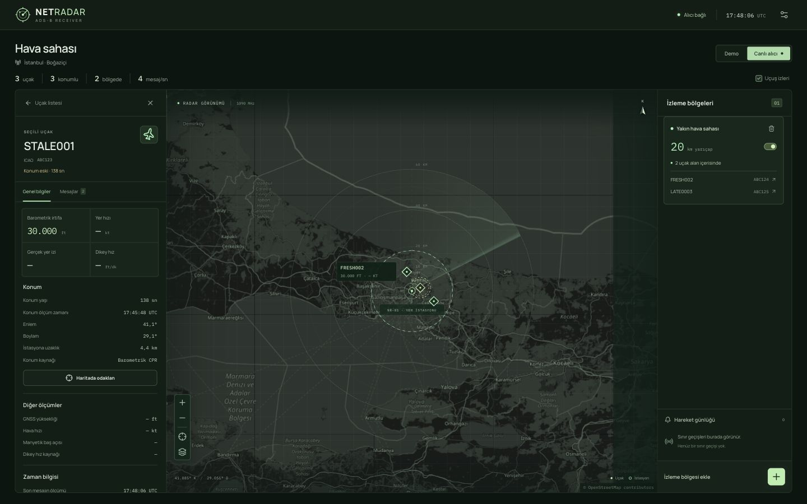

# Konum sıralaması ve güncelliği düzeltmesi

Bu belge, geç gelen eski bir mesajın uçağı haritada geri taşıması ve çağrı adı
mesajlarının eski koordinatı güncel göstermesi sorunlarını açıklar.

## 1. Hata nasıl oluşuyordu?

`AircraftStore.apply()` koordinatları her konum mesajında doğrudan atıyordu.
Yalnızca `last_seen_unix_ms` için eski zamanın üzerine yazılmasını engelleyen
bir kontrol vardı. Böylece son görülme saati yeni kalırken koordinat eski bir
mesajdan gelebiliyordu.

Frontend ise her güncellemede `receivedAt` alanını yeniliyordu. Bu alanın görevi
**herhangi bir mesajın tarayıcıya gelişini** takip etmekti; konumun yenilendiğini
kanıtlamıyordu. Çağrı adı mesajları devam ettiğinde eski koordinat da canlı
trafik gibi görünüyordu.

## 2. Hangi mesajı hangisiyle karşılaştırıyoruz?

Karşılaştırma, son görülen herhangi bir mesajla değil **son kabul edilen konumla**
yapılır. Şu geliş sırası geçerlidir:

| Gelen mesaj | Ölçüm zamanı | Sonuç |
| --- | --- | --- |
| Konum A | 12:00:10 | İlk konum kabul edilir. |
| Çağrı adı | 12:00:20 | Son görülme saati yenilenir; konum zamanı değişmez. |
| Gecikmiş konum B | 12:00:15 | A'dan yeni olduğu için kabul edilir. |
| Daha eski konum C | 12:00:05 | Koordinatı değiştiremez. Ham mesaj yine iletilir. |

`netradar/backend/state.py` içinde `_compare()` ve `_accept()` bu kararı verir.

- İki mesajın ölçüm zamanı varsa önce o zamanlar karşılaştırılır.
- Ölçüm zamanları aynıysa veya biri/yoksa, **aynı capture_id, kaynak ve örnekleme
  hızındaki** örnek indeksleri karşılaştırılabilir.
- Eşit zaman ve indeks aynı konumu yeniden kabul ettirmez.
- Farklı kayıt oturumlarının örnek indeksleri birbirleriyle karşılaştırılmaz.
- Zamanı bilinmeyen ve karşılaştırılamayan bir konum, eldeki konumu değiştirmez.
  Hiç konum yoksa ilk çift tutulabilir; sonraki belirsiz çiftlerle ezilmez.
- Mutlak zamanı olmayan yeni bir kayıt oturumuna geçerken yeni `AircraftStore`
  kullanılır. İki ayrı kaydın hangisinin daha yeni olduğunu var olmayan bir
  saatten çıkarmıyoruz. Tarihli mesajlar mutlak zamanla karşılaştırılabilir.

Decoder her kayıt oturumu için bir `capture_id` üretir; `reset()` yeni kimlik
oluşturur. `ModeSFrame.observed_at_unix_ms` isteğe bağlıdır. Gerçekten ölçülmüş bir
saat verildiyse decoder onu taşır. Verilmezse `None` kalır; RF gözlem zamanı
uydurulmaz. CPR çiftinden çıkan konumun zamanı, seçilen yeni çerçevenin zamanıdır.

İrtifa ve hız gibi özet ölçümler de kendi kabul edilmiş ölçümleriyle karşılaştırılır;
eski tarihli bir mesaj bu alanları geriye götüremez. Mevcut v1.1'de zamanı olmayan
eski scalar olaylar geliş sırasıyla işlenebilir; koordinat kontrolü daha katıdır.

## 3. Backend artık neleri ayrı tutuyor?

| Alan | Anlamı |
| --- | --- |
| `last_seen_unix_ms` | Uçağa ait en yeni ölçülmüş herhangi bir mesajın zamanı. |
| `position_observed_at_unix_ms` | Kabul edilmiş koordinatın gerçek ölçüm zamanı; yoksa null. |
| `position_received_at_unix_ms` | Backend'in o koordinatı kabul ettiği yerel saat; ölçüm zamanı değildir. |
| `position_revision` | Gerçekten yeni bir konum kabul edildiğinde artar. |
| `position_event` | Haritadaki koordinatın ait olduğu tam decoder mesajı. |
| `position_age_ms` | Güncelleme/snapshot üretilirken hesaplanan konum yaşı. |

Konumun yaşı, varsa ölçümden kabul anına kadar geçen süreyle başlar. Sonrasında
`time.monotonic()` ile büyür; sistem saati sonradan değişse de sayaç geri gitmez.
Mutlak zaman yoksa kabulden itibaren geçen süre kullanılır. Kayıt hızlı işleniyorsa
aynı kayıttaki en ileri örnek indeksiyle fark da hesaba katılır; 40 saniyelik
kayıt anında işlense bile ilk konum yeniymiş gibi kalmaz.

`position_age_ms` her `snapshot()` çağrısında da yeniden hesaplanır. Bağlantı yeniden
kurulduğunda eski bir snapshot almak, konumu sıfır saniye yaşında yapmaz.

`latest_events` hâlâ son **gelen** mesajları içerir. Gecikmiş eski mesajlar da
`aircraft_update.event` içinde eksiksiz teslim edilir. `position_event` ise son
**kabul edilen koordinatı** açıklayan mesajdır. Bu ayrım veri kaybı olmadan
haritanın güvenilir kalmasını sağlar.

## 4. Frontend nasıl davranıyor?

`frontend/src/lib/freshness.ts` konum güncelliğinin tek sorumlusudur:

1. Backend'den gelen yaşı ve konumun kimliğini alır.
2. `performance.now()` ile geçen süreyi ekler. Kullanıcının bilgisayar saatinin
   ileri/geri alınması bu süreyi değiştirmez.
3. Aynı konumu taşıyan çağrı adı/hız mesajları ve aynı çerçevenin tekrarı yaş
   sayacını sıfırlamaz.
4. Gerçekten yeni bir konumda yaş yeniden hesaplanır. Uçak sabitse koordinat aynı
   kalabilir; daha yeni zaman/örnek indeksi yenilenmeyi kanıtlar.
5. Snapshot'ın zamanı ve yaşı belirlenemiyorsa durum `unknown` olur; gelişi şimdi
   gerçekleşti diye yeni bir RF ölçümü kabul edilmez.
6. Beklenmedik şekilde geriye giden bir konum güncellemesi tarayıcıya ulaşırsa
   frontend de harita koordinatını korur; gelen ham mesaj incelemeye açık kalır.

Varsayılan eşik `POSITION_STALE_AFTER_MS = 30_000` değeridir. Bu uygulama
tercihidir; protokolün zorunlu bir sınırı değildir. 30 saniye dolduğunda:

- Uçak listesi ve detayları kaybolmaz.
- Haritadaki işaret sarı/kesik olarak ayrılır; etiket konumun eski olduğunu söyler.
- Detayda konum yaşı ve konuma ait ölçüm zamanı ayrı görünür.
- Eski/belirsiz konum güncel bölge sayımına katılmaz.
- Konum eskidi diye fiziksel bir “bölgeden çıktı” bildirimi üretilmez.
- Belirsiz aralıktan sonra yeni konum gelirse ilk ölçüm yeni bir başlangıçtır;
  gözlemleyemediğimiz aralıktaki geçişler uydurulmaz. Ardından gözlenen gerçek
  sınır değişimleri yeniden bildirilir.

Uçağın son mesajından itibaren 60 saniyelik mevcut silinme kuralı ayrıdır. Yalnızca
çağrı adı mesajları gelen uçak listede kalabilir; bu onun konumunu güncel yapmaz.
Demo modu kurgusal bir simülasyondur; duraklatmak demo konumlarını RF verisi gibi
eskimeye zorlamaz.

## 5. Doğrulama

Python regresyonları: `tests/test_state_freshness.py`.
Frontend regresyonları: `frontend/tests/freshness.test.ts`.

Kapsanan durumlar: eski mesaj, geç gelen ama önceki konumdan yeni mesaj, yinelenen
CPR sonucu, durağan uçakta yeni ölçüm, mutlak saatsiz aynı/farklı kayıt, eski
snapshot, yeni çağrı adı altında yaşlanan konum, ölçüm/istemci saati ayrımı ve
belirsizlik sonrası sahte bölge geçişlerinin engellenmesi.

```bash
python3 -m unittest discover -s tests -q
cd frontend
npm test
npm run build
```

Ek olarak, geçici ve yalnızca localhost'a bağlı bir test akışıyla gerçek
`AircraftStore` çıktısı tarayıcıya HTTP/WebSocket üzerinden verildi. Üç kurgusal
uçaktan birine yalnızca yeni çağrı adı mesajları gönderildi. Konum eski kaldı,
bölge sayımı iki oldu. Başka bir uçağa gönderilen eski koordinat güncel konumu
bozmadı. Bu yardımcı test sunucusu üretim backend'i değildir ve proje servislerine
eklenmemiştir. Kontrolden sonra kapatıldı, önceki backend adresi geri yüklendi.


