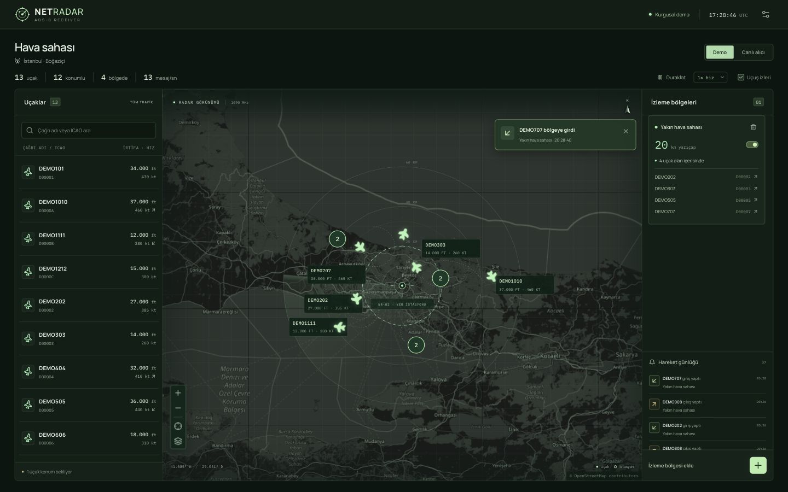

# NetRadar desktop interface

React + TypeScript + Vite + Leaflet, built for a desktop ADS-B receiver display.
The dashboard uses Turkish labels and a dark green radar theme. The receiver is
passive: sweep/ripple effects are visual decoration, not RF transmission.



## Run

Use Node.js **22.12+ or 24+** and npm. From the repository root:

```bash
cd frontend
npm ci
npm run dev
```

Open **http://127.0.0.1:5173**. For access from another computer on your LAN use
`npm run dev -- --host 0.0.0.0`. The default development server binds only locally.

```bash
npm test        # Contract, geography, geofence, layout and live-transport tests
npm run build   # Strict TypeScript check and production bundle in dist/
npm run preview
npm run format
```

The interface is designed for **1280×720 and larger**, with independent scrolling
panels. A minimum 1100×690 canvas preserves controls at smaller desktop sizes;
smaller windows scroll the whole canvas instead of becoming a phone layout.
1440×900 or larger leaves more space for the map and details.

## Using the dashboard

The layout focuses on three surfaces: aircraft list/details, radar map, and zones.
There is no navigation rail. Receiver settings remain in the header, while search,
map recentering and movement history are available in their relevant panels.
Four compact counters above the map replace the full-width statistics card; the
same total, positioned, zone-membership and message-rate figures remain available.


- **Demo** starts with fictional Istanbul aircraft from the shared mock JSONL
  fixture, plus additional explicitly fictional contacts. There are 12 positioned
  aircraft and one awaiting position. Closed simulated routes stay around
  Istanbul during long demos. Position, track and zone membership change together.
  The default is 4× simulation speed; choose 1×/4×/12× or pause it. Updates arrive
  once per second. No synthetic raw frame or CRC claim is fabricated.
- Click a plane, aircraft list row or zone member to open the **left detail panel**.
  General measurements and raw message tabs stay in the same fixed column.
  The map doesn't lose width when a detail tab opens. Escape closes selection.
- Plane orientation uses **`track_deg` (true ground track)**. `heading_deg` is
  magnetic heading, shown separately. Missing track uses a diamond rather than
  inventing a direction. Ground speed vs IAS/TAS and barometric altitude vs GNSS
  height are kept separate. Zero is a real measurement; missing values show “—”.
- Geographically close planes become a numbered, selectable group, without
  displacing actual fixes. Click it to choose a member. Labels avoid each other,
  marker hit targets, the receiver and map controls. Labels that don't fit are
  omitted; every contact remains accessible from the aircraft list.
- The **bottom-right +** opens the zone form. Set a name and **1–250 km** radius;
  the slider covers 1–150 km. A dashed circle previews the area before saving.
  Up to 12 receiver-centered zones can coexist. Counts/names use the full traffic
  set, regardless of search or map viewport. Zones can be disabled or deleted.
  Receiver settings and zones persist locally in this browser.
- Only **fresh** fixes count toward zone members and counts. A coordinate that has
  not been refreshed for 30 seconds stays visible with an amber/dashed marker and
  an age label, but is excluded from zone counts. New callsign messages do not
  refresh coordinate age. Unknown-age snapshots are marked unknown. A stale fix
  expiring or resuming is not a physical zone exit/entry.
- Zone crossings produce dismissible in-app notifications and a movement log.
  First load, creating/editing a zone, changing receiver and reconnecting establish
  a silent baseline. A 150 m exit hysteresis reduces noisy repeated alerts at the
  boundary. Counts use the exact radius, so a contact just outside the radius can
  stop counting up to 150 m before its exit alert. Lost position, stale contact
  removal and disconnect are not reported as physical exits. These alerts describe
  sampled fixes, not undetected crossings between two messages. History is bounded
  to 80 events per data session; the sidebar shows the newest 30, toasts last 7 s. Only the newest toast is expanded, keeping the map readable
  during simultaneous crossings; every transition remains in the movement log.
- Map zoom/pan, receiver recentering, basemap and trajectory toggles work without
  reloading the page. Each contact retains at most 60 measured trail points.
- Reduced-motion preferences disable sweep/ripple and marker transitions.

## Data sources and decoder details

The user interface has two modes: fictional **Demo** traffic and the **Canlı alıcı**
backend connection. There is no file-upload button or file replay mode in the UI.
The mock JSONL fixture remains an internal demo seed and the Python JSONL pipeline
remains available to developers; neither needs a separate operator control.

Every live `event`, unknown nested `fields` / `metadata` extension, and
`data.latest_events` payload is preserved and available in the message view or
“Tüm uçak verisi”. See [contracts v1.1](../docs/CONTRACTS.md).

## Live backend adapter (server provided by backend module)

The FastAPI service in `netradar/backend/server.py` now hosts HTTP and WebSocket.
See the [step-by-step backend guide](../docs/LIVE_BACKEND.md) to start it and
forward decoder events. Configure its base URL in the settings dialog, or
copy `.env.example` to `.env.local` and set `VITE_BACKEND_URL`. Then choose **Canlı
alıcı**. Implemented backend contract:

1. `GET /api/aircraft` returns the **plain array** from `AircraftStore.snapshot()`.
2. `WS /ws/aircraft` sends one complete `aircraft_update` v1.1 envelope per message:

   ```json
   {"schema_version":"1.1","type":"aircraft_update","data":{"icao":"ABC123","latest_events":{}},"event":null}
   ```

   The shortened object above illustrates framing only; real `data` contains the
   complete aggregated state and real `event` contains the complete decoder event.
3. Subscribe the WebSocket before serving the snapshot. The UI buffers events
   until snapshot installation, then applies them in arrival order. The backend
   registers each subscriber before accepting its WebSocket. Its `stream_id` and
   `stream_sequence` appear on the envelope, aircraft summary and snapshot entries;
   the UI ignores older/equal summaries within that stream, retaining the raw event.
   This prevents buffered summaries from rolling a newer snapshot back. Stream
   order is separate from RF measurement order and does not refresh old positions.
4. Allow the frontend origin with CORS for HTTP and WebSocket origin validation.
   For an HTTPS frontend use an HTTPS/WSS backend. If using a path prefix, e.g.
   `https://host/radar`, routes become `/radar/api/aircraft` and `/radar/ws/aircraft`.

The client reconnects with 1–15 s exponential backoff, gets a fresh snapshot on
each reconnect and aborts previous requests when switching sources/unmounting.
Initialization has a 10 s timeout and a 5,000-event buffer limit. Incompatible
schema/data closes the stream and shows an error; **live failures never fall back
to demo aircraft**. View updates are batched at 200 ms; the server controls message
frequency. Live positions are only received fixes, with no speed-based prediction.

For UI lifecycle purposes, live contacts expire **60 s after last local receipt**
while connected. Disconnect freezes remaining fixes and marks them as stale. This
receipt timestamp is shown separately from the measured `last_seen`; an absent
measurement time remains unknown. The display retains at most 10,000 contacts.
These are frontend memory/display limits, not changes to backend state semantics.

## Module layout

```text
src/
  components/        map, flight details/list, zones, notifications, settings
  data/              separate demo generator and real HTTP/WebSocket transport
  hooks/             traffic lifecycle, batching, zones and notification state
  lib/               wire validation, position freshness, geodesy, geofences, collision layout
  styles/            theme, layout, flights, map, zones, utilities, desktop sizing
  types.ts           extensible v1.1 wire types and local UI types
  config.ts          replaceable map tile URL/attribution
```

## Assets

- Plane silhouette downloaded from [Tabler Icons](https://github.com/tabler/tabler-icons/blob/main/icons/filled/plane.svg), MIT;
  original SVG and license are in `public/icons/`. Its native east-facing silhouette
  is rotated by `track_deg - 90` to align north-based bearings.
- Other controls: [Lucide](https://lucide.dev/), ISC. Map engine:
  [Leaflet](https://leafletjs.com/), BSD-2-Clause.
- Manrope and IBM Plex Mono are bundled locally via Fontsource with OFL licenses;
  loading fonts or plane icons does not require an external request.
- The default geographic basemap uses [OpenStreetMap standard tiles](https://operations.osmfoundation.org/policies/tiles/)
  with visible attribution and ordinary browser caching. It needs internet access;
  radar, contacts, circles and selection work without it. No bulk tile download or
  offline tile archive is made. For another provider, set `VITE_MAP_TILE_URL` and
  `VITE_MAP_ATTRIBUTION`, then rebuild. The green filter is tuned for light tiles.
- Bundled third-party notices are in `public/licenses/` and `public/icons/`.

Tested in the desktop browser at 1280×720 and 1440×900 (with a 1920×1080 layout check), including plane selection,
aircraft details, zone creation/removal and unavailable live server state.
The simplified layout is also checked for panel separation at 1280×720. The live
RTL-SDR producer is connected to the FastAPI backend; real hardware is still needed to verify the
full RF → DSP → decoder → live UI chain.

Position-age behavior, clock rules and regression examples are explained in
[the Turkish walkthrough](../docs/POSITION_FRESHNESS.md).
